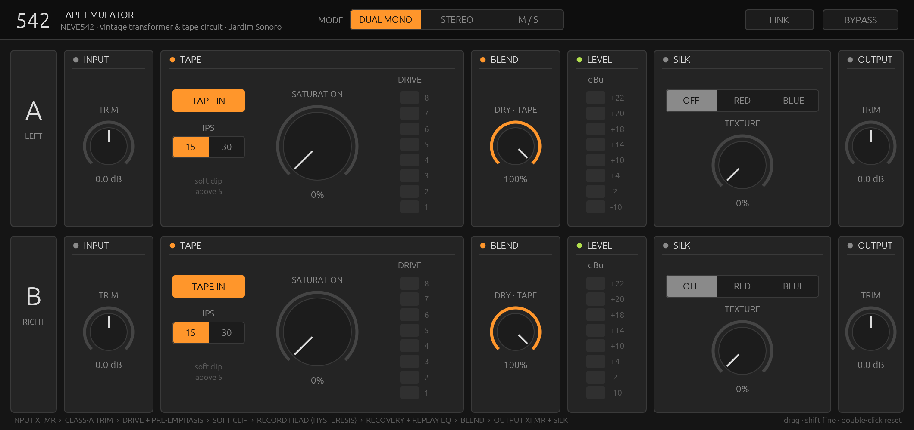

# NEVE542 — Vintage Dual Tape Emulator (Jardim Sonoro)

> A dual-channel tape and transformer emulator in Rust on the [truce](https://github.com/truce-audio/truce) framework. At its core is a component-level model of the Rupert Neve Designs 542 Tape Emulator (500 series), calibrated against the **hardware's** published Audio Precision measurements rather than against another plug-in. Where no measurement exists, NEVE542 makes documented choices for the sound of an aged, hand-matched unit; see [Character](#character-the-vintage-unit).
>
> NEVE542 is an independent product. It is not affiliated with or endorsed by Rupert Neve Designs, and "542" and "Rupert Neve" are mentioned only to identify the hardware that was modelled.

Formats: AU · VST3 · CLAP · Standalone (macOS). Modes: Dual Mono · Stereo · Mid/Side, with offset-preserving Link.



---

## Results

All numbers come from `tools/compare.py`: a stepped-sine analyzer (phase-free least-squares fit of H1–H10, plug-in warmed up before each measurement) run on the installed AU at 96 kHz, 0 dBu = −18 dBFS. The hardware curves are digitized from the AP plots in the 542 operations manual (`tools/hw/rnd542_ap_curves.json`). "RND plug-in" is the official Rupert Neve Designs 542 plug-in measured the same way.

**Frequency response at 0 dBu: error against the hardware (RMS / max, 10 Hz – 40 kHz)**

| Setting | This model | RND plug-in |
| :-- | :-- | :-- |
| 15 IPS, Sat MIN | 0.14 / 0.49 dB | 1.57 / 6.29 dB |
| 15 IPS, Sat 10 o'clock | 0.16 / 0.49 dB | 1.46 / 5.49 dB |
| 15 IPS, Sat 2 o'clock | 0.16 / 0.51 dB | 3.42 / 12.0 dB |
| 15 IPS, Sat MAX | 0.20 / 0.58 dB¹ | 3.73 / 13.0 dB |
| 30 IPS, Sat MIN | 0.11 / 0.30 dB | 0.71 / 2.75 dB |
| 30 IPS, Sat 10 o'clock | 0.11 / 0.38 dB | 0.99 / 3.14 dB |
| 30 IPS, Sat 2 o'clock | 0.14 / 0.50 dB | 2.86 / 10.7 dB |
| 30 IPS, Sat MAX | 0.15 / 0.49 dB¹ | 3.11 / 11.3 dB |
| SILK Red, Texture MAX (tape out) | 0.15 dB RMS | 6.10 dB RMS |
| SILK Blue, Texture MAX (tape out) | 0.10 dB RMS | 4.15 dB RMS |

¹ The largest errors sit at 10 Hz and above 20 kHz, at the edge of the oversampler's half-band filter (96 kHz host). Measured on channel A, the calibrated reference; channel B carries the vintage tolerances described under Character.

**THD at 0 dBu, 15 IPS (%), all four Saturation positions from the hardware plot**

| Saturation | | 20 | 30 | 40 | 60 | 100 | 200 | 500 | 1k | 3k | 10k |
| :-- | :-- | --: | --: | --: | --: | --: | --: | --: | --: | --: | --: |
| MIN | Hardware | 4.74 | 3.29 | 2.64 | 2.02 | 1.45 | 0.86 | 0.34 | 0.16 | 0.09 | 0.10 |
| | This model | 5.00 | 3.82 | 3.10 | 2.26 | 1.47 | 0.80 | 0.41 | 0.22 | 0.12 | 0.07 |
| 10 o'clock | Hardware | 5.77 | 4.42 | 3.68 | 2.83 | 1.98 | 1.10 | 0.47 | 0.36 | 0.15 | 0.05 |
| | This model | 5.73 | 4.36 | 3.56 | 2.67 | 1.85 | 1.06 | 0.47 | 0.30 | 0.16 | 0.05 |
| 2 o'clock | Hardware | 6.68 | 5.16 | 4.30 | 3.26 | 2.25 | 1.23 | 0.66 | 0.58 | 0.26 | 0.05 |
| | This model | 6.55 | 4.92 | 4.02 | 3.12 | 2.27 | 1.41 | 0.65 | 0.36 | 0.14 | 0.05 |
| MAX | Hardware | >10 | >10 | 5.06 | 3.95 | 3.76 | 2.87 | 1.48 | 1.05 | 1.87 | 3.20 |
| | This model | 12.6 | 8.13 | 5.95 | 4.37 | 3.38 | 2.56 | 1.53 | 1.15 | 1.54 | 3.16 |
| any | RND plug-in | 0.00–3.1 | 0.00–4.7 | 0.01–5.6 | 0.00–6.4 | 0.00–6.3 | 0.00–4.8 | 0.00–3.3 | 0.00–3.1 | 0.00–3.2 | 0.00–2.9 |

RMS error of this model against the hardware THD, in dB: 1.8 / 0.6 / 2.2 / 1.0 for MIN / 10 / 2 o'clock / MAX, 1.55 overall. v0.2.0 scored 1.7 / 0.9 / 2.2 / 1.4, and v0.1.0 2.0 / 1.8 / 3.3 / 5.2. At MIN, most of the remaining error comes from the 1–3 kHz points, where both values sit near the analyzer floor (≈ 0.1 %). The RND plug-in reads ≈ 0 % at the first three positions and roughly flat 3–6 % at MAX.

The RND plug-in is essentially distortion-free below about +6 dBu and then clips, with the same THD at 1 kHz and 8 kHz. The hardware distorts at normal levels and its distortion rises as `1/f`, which is the signature of the magnetic core. That low-level, frequency-dependent behaviour is what this model reproduces.

Known gaps:
- On the 10 and 2 o'clock traces, the hardware THD steps down sharply near 2 kHz, from a 0.36 / 0.58 % plateau. No smooth mechanism reproduces that step; it looks like an analyzer range change. The model stays about 2–4 dB below that plateau at 1 kHz.
- At Saturation MAX, 40 Hz is about 1.4 dB high. (In v0.2.0 it was 3 dB. Most of that came from the clip's rectified DC reaching the head, which the coupling capacitor now blocks.)
- 30 IPS has no published THD plot, so its non-linear behaviour follows from the 15 IPS fit and the 30 IPS frequency response.
- The hardware publishes no harmonic breakdown for any setting. The H2/H3 balance, the behaviour above 0 dBu and SILK's harmonics are design choices; see Character.

Validation: `auval` and `pluginval --strictness-level 5` pass. `examples/stress.rs` drives every mode at 44.1–192 kHz with silence, DC, noise, +12 dBFS square bursts and denormal-range input; the output stays finite throughout.

CPU: about 0.5 % (tape out) to about 4.7 % (Saturation MAX + SILK) of one Apple-silicon core per channel at 48 kHz.

---

## Character: the vintage unit

No 542 was available to measure. The published plots fix the frequency response and the THD at 0 dBu, but not the harmonic balance, the behaviour above 0 dBu, noise, or unit variation. For those, NEVE542 reverse-engineers the RND plug-in where it is informative and otherwise makes choices drawn from the hardware literature, reviews and forum lore. The result is meant to sound like a well-used, hand-matched unit, and every choice is listed here.

**What the RND plug-in measures like** (`analyzer.py`, warmed up and with silence between tones):
- A static waveshaper with a threshold. It is clean (< 0.01 %) up to about +6 dBu at Saturation MIN and then mostly H3 + H5, identical at 1 kHz and 5 kHz.
- It has no 1/f transformer distortion at 0 dBu, although the hardware plots show 1.5–5 % below 100 Hz.
- SMPTE IMD is 0.003 % at MIN and 0 dBu.
- SILK distortion is mostly H2, about 2.3 % at +16 dBu (Red, Texture MAX, 100 Hz).
- It has zero latency and no noise.

**Design choices and their sources**

| Trait | Choice | Basis |
| :-- | :-- | :-- |
| Low-frequency colour | Transformer-core 1/f distortion, predominantly H3, kept from the hardware fit | SOS on the 5042: "considerable amounts of low-frequency distortion (predominantly third harmonic)"; the hardware AP plots |
| Soft clip | Diode pair deliberately mismatched (Is ratio 1:12.5), so H2 rises with the clip before H3 takes over (at 5 kHz, Sat MAX, 0 dBu: H2 1.8 %, H3 1.5 %) | RND: the soft clip "enhances 2nd-order harmonics"; SOS 542 review. Rupert Neve, citing Moir, held that odd harmonics are more readily heard and "spoil" listening while even ones are benign, increasingly so at high frequency. A Gearspace user on the RND plug-in: "when it distorts it gets nasty". |
| Clip ↔ head coupling | A 4 Hz coupling capacitor between DRIVE amp and head. The clip's rectified DC now shifts the bias for a moment instead of magnetising the head, so heavy clipping breathes with the programme. | Standard practice for any amplifier driving a transformer. Without it, v0.2.0 reached 30 % H2 and −5 dB of spurious gain loss at 50 Hz, +12 dBu. |
| Head remanence | A small remanent flux in the record head (an un-demagnetised head) tilts the saturation curve. It adds H2 that grows with level (50 Hz, 0 dBu: H2/H3 ≈ 0.35; +12 dBu: ≈ 0.55) while the low end stays H3-led. | Tape-machine practice of regular head demagnetising, because magnetised heads add even-order distortion and hiss |
| SILK | Output stage curvature raised and output-core hysteresis lowered, so Texture is mostly 2nd order: about 3 % H2 at +16 dBu and approaching 4–5 % just before the output stage reaches its rails (above about +20 dBu, rail clipping adds H3). The Blue shelf is re-trimmed so the response still matches the AP plot within 0.1 dB. | RND / dealer copy: "effect ranges from essentially absent to roughly 4–5 % THD (mostly second order)"; the RND plug-in's SILK is H2-dominant too |
| Channel matching | Channel A is the calibrated reference. Channel B carries the tolerances of a 40-year-old matched pair: head bump +1.8 % in frequency and +0.12 dB, DRIVE pot tracking +0.15 dB, head saturation −3 %, more remanence, slightly different diodes and SILK core. A and B differ by ≤ 0.06 dB at 0 dBu. | Unit-to-unit variation of vintage Neve modules (GroupDIY and Gearspace recap/restoration threads). Reviewers credit the hardware with more "depth" than plug-ins, and small L/R differences are one physical source of that. |
| Noise | Uncorrelated hiss per channel, about −98 dBu (−116 dBFS), split between input (rises with TRIM) and output stage. That is a couple of dB above the spec's "better than −100 dBV" for an aged unit. | 542 specification; SOS and Tape Op note audible hiss when the 5042 is driven to extremes |
| IMD | Left as the core physics gives it: SMPTE 5 % at MIN and 0 dBu. That is tape-like, where a voltage-driven line transformer would be about ten times lower (Jensen). | The 542's head stage is a constant-current-driven "tape" transformer, not a line transformer. Its low-frequency flux is meant to modulate the highs the way tape does. |

Not modelled on purpose: wow and flutter, dropouts and tape hiss modulation. The 542 has no transport, and its character is electronic and magnetic.

---

## The model

### Sources
- RND 542 operations manual: block diagram, specifications, and the four AP plots (`tape_emulator.pdf`).
- RND 542 plug-in user guide (`manual.pdf`).
- Sound On Sound reviews of the Portico 5042 and the RND 500 series. Key points: a constant-current drive into inductively coupled coils; LF distortion is "predominantly third harmonic"; the soft clip adds 2nd harmonic at higher levels; Silk Red adds about +1.5 dB overall and +3 dB above 5 kHz; Silk Blue adds about +1.5 dB at 30 Hz.
- RND's own description of Silk: it reduces the negative feedback taken from the output transformer and changes that feedback's frequency response.
- Reverse engineering of the RND 542 plug-in (harmonics vs level, pot taper, IMD, SILK, Blend, latency, noise), and forum and press discussion (Gearspace, GroupDIY, Steve Hoffman forums, Tape Op, Jensen/Whitlock transformer notes) for the Character choices.
- No schematic of the 542 or 5042 has been published. Earlier versions of this README cited "US Patent 7,454,025" for Silk. **That was wrong.** US 7,454,025 is a Panasonic loudspeaker patent and has nothing to do with Neve.

### Signal chain (per channel, `neve542/src/channel.rs`)

```
IN → input transformer (mu-metal: 0.8 Hz HP, tiny hysteresis) → Class-A TRIM stage (±16 V rails)
   ├── dry ──────────────────────────────────────────────────────────────────────┐
   └── DRIVE amp: record share of the LF bump, IPS pre-emphasis (NAB 50 µs /      │
       AES 17.5 µs, shelved) → diode soft clip (anti-parallel, Newton-solved)    │
       → 4 Hz coupling cap → SATURATION TRANSFORMER "record head" (Preisach,       │
         remanent flux)                                                          │
       → RECOVERY amp: 1/DRIVE (counter-ganged), de-emphasis, replay contour ─────┤
                                                                         BLEND ──┘
   → blend amp → [LEVEL meter] → output stage + output transformer with SILK → OUT
```

Everything non-linear runs at ≥ 176.4 kHz. The oversampler is a zero-latency polyphase IIR half-band using the elliptic design from *hiir*: passband flat to 20 kHz at 44.1 kHz, images below −90 dB.

**Magnetic cores (`magnetics.rs`).** A voltage-driven winding sets the flux, Φ = ∫v dt, so flux grows as 1/f. Hysteresis is a discrete Preisach model in Prandtl–Ishlinskii form: 32 play operators on a quadratic threshold grid with a fitted coercivity density. A uniform density gives Rayleigh's law, with distortion proportional to flux, mostly H3. The hardware rises more slowly, about as flux^0.7 over a 50:1 range, until hard saturation. The fitted density therefore has a power-law tail, p(r) ∝ r^−γ, the broad coercivity distribution of soft steels. The model carries memory and phase lag, and its permeability rises with amplitude, which produces the low-frequency "bloom". A Langevin-like anhysteretic knee follows. The secondary voltage is dΦ/dt, implemented as the exact discrete inverse of the integrator, so an ideal core is bit-transparent. All non-linear parameters of the record path are fitted jointly to all four THD curves and to the Saturation MAX frequency response (`tools/fit/fit_thd.py`): core, clip threshold, 15 IPS pre-emphasis shelf, the drive gain at each pot position (inside its Drive-meter LED window) and the record/replay split of the head bump.

**Where the head bump lives.** A bump placed entirely after the core raises the H3 of a 20 Hz tone (at 60 Hz) relative to its fundamental. THD would then climb much faster than 1/f below 100 Hz, and the hardware's doesn't. The fit puts about 40 % of the bump (in dB) in the record path, where it also shapes the flux. As Saturation rises, the core compresses that part of the bump, which matches the hardware's bump getting smaller at higher Saturation.

**Clip and HF THD.** At Saturation MAX the hardware reaches 3.2 % THD at 10 kHz, from the soft clip acting on the pre-emphasised highs. An exponential diode clip always compresses the fundamental along with it, about 1.4 dB for 3 % THD whatever its knee. The recovery amp's 1st-order HF shelf in the replay contour compensates that at the 0 dBu reference level, the same model-in-the-loop principle used for the LF bloom. At 15 IPS MAX the fitted shelf is +2.3 dB, centred at 5.7 kHz. Everywhere else it stays within ±1 dB.

**Replay contour (`tape.rs`).** A 2nd-order high-pass, a head-bump peak, a 2nd-order gap-loss low-pass and a 1st-order HF shelf at each documented pot position, interpolated between positions. They were fitted with the full non-linear model in the loop, because the AP curves were taken at 0 dBu where the core already adds level-dependent gain (`tools/fit/refit_contour.py`). The refit evaluates the exact digital (prewarped bilinear) response at the plug-in's real internal rate of 176.4/192 kHz.

**SILK (`silk.rs`).** A feedback model. Each fitted Red/Blue section N/D is opened by the Texture fraction t, giving N / ((1−t)N + tD): flat at t = 0, the measured curve at t = 1. The open-loop distortion of the single-ended output stage (H2, proportional to level) and of the output-transformer core (H3, proportional to 1/f) is computed on the signal and injected through the loop sensitivity S = 1/(1+T). Red raises S in the upper mids and highs, Blue in the lows.

**Meters.** DRIVE uses 8 LEDs, 3 dB apart: LED 2 = nominal, and soft clip starts above LED 5. LEVEL is the hardware's −10 / −2 / 4 / 10 / 14 / 18 / 20 / 22 dBu scale, taken pre-SILK. Both have LED ballistics.

### Interface
The panel is drawn with egui. Each channel is one row in signal-flow order: INPUT → TAPE (Tape In, IPS, Saturation, Drive meter) → BLEND → LEVEL → SILK → OUTPUT, styled after Ableton Live's flat dark panels. Rows are labelled A/B or MID/SIDE depending on mode. In Stereo mode row B is dimmed because channel A controls both. LINK keeps the relative offset between channels, as the RND manual specifies. Controls: drag, shift-drag for fine, double-click to reset, scroll wheel.

---

## Building

```bash
cargo install cargo-truce
cd neve542
cargo truce install --au2             # AU into ~/Library/Audio/Plug-Ins/Components
cargo truce build --au2 --vst3 --clap # all bundles into target/bundles/
cargo run --bin neve542-standalone --features standalone
```

## Measuring and calibrating

```bash
python3 tools/compare.py                                   # ours (AU) vs RND plug-in vs hardware
cargo run --release --example probe -- ips=15 sat=1 level=0   # DSP-level AP sweep
cargo run --release --example stress                       # robustness + CPU
cargo test --release --lib                                 # filter/oversampler/core/stage unit tests
tools/fit/calibrate.sh                                     # full tape-path calibration:
                                                           #   fit_thd.py (non-linear) <-> refit_contour.py
python3 tools/fit/fit_silk.py                              # refit SILK curves
```

## Credits & license
Modelled hardware: the 542 Tape Emulator by Rupert Neve (1926–2021) and Rupert Neve Designs. NEVE542 is an independent product, not affiliated with or endorsed by RND. DSP, Rust implementation and UI: Jardim Sonoro ([nagualcode](https://github.com/nagualcode)). MIT license.
